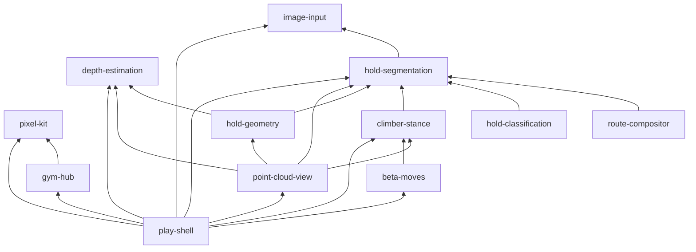
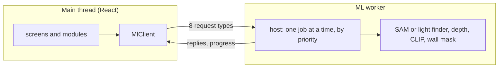

# Architecture: a top-down tour

A map of bouldering_vis for someone new to it. It covers what the app does for a climber, which
module does what, one photo traced through the code, where the ML runs, and how it's tested. The
SPECs say what each part *should* do. This page says what the code does today, and every
disagreement found is a numbered [follow-up](#follow-ups).

Checked against `main` at `489ff4f` on 2026-11-05. Code is cited as `path:line`. A citation that
has drifted after an edit is a bug in this page.

## 1. What it does for a climber

Everything runs in the browser. There is no server and no account, and the photo stays on the
device (`SPEC.md:189`). The app has three places, each a hash route (`src/app/route.ts:18`):

| Place | URL | What you do there |
|---|---|---|
| **The gym** | `#/gym` | A walkable pixel gym, with no visible way in since the Wall 2 launch (`#/` opens Wall 2's Play screen, SPEC-launch-wall-2 R3). Walk with ← → (◀ ▶ on a phone) to a door: a wall bay, **New wall**, or the **Setting Room**. |
| **The Setting Room** | `#/studio` | The analysis screen (`App` in the code). Bring a wall photo by paste, drop, file, camera or sample. Tap holds, and tag 1–2 starts and 1 finish (`SPEC.md:33`). Then switch views: **Original**, **Route** (your holds in color on a flat grey wall), **Depth** (a heatmap) and **3D** (an orbitable point cloud). Each hold gets a card with its type (crimp, jug, sloper…), a confidence meter and a pull direction. A stick climber shows a start position, with each limb's share of body weight. |
| **Play** | `#/wall/<id>` | The game on one wall. Tag a route, then plan it move by move. A referee judges each move and explains a fall in climbing words. A pixel climber is drawn over the real photo. |

## 2. Module map

Each module is a folder under `src/modules/` with one SPEC and one public entry, `index.ts`. Other
modules import it only through that file (`SPEC.md:136-138`). `eslint.config.js:6-14` enforces
this, and also allows a second entry, `worker.ts`, for pure functions the ML worker needs.

| Module | What it does | Entry | SPEC (status) |
|---|---|---|---|
| `image-input` | Paste, drop, file, camera or sample → one working image, long edge ≤ 1536 px (`src/modules/image-input/size.ts:1`) | `index.ts` | [image-input](../SPEC-image-input.md) (approved) |
| `hold-segmentation` | A tap → a clean hold mask; the selected holds and their roles; the photo canvas | `index.ts` | [hold-segmentation](../SPEC-hold-segmentation.md) (approved) |
| `route-compositor` | The Route picture: your holds' real pixels, wall `#2B2B2B`, other holds `#8A8A8A`; chalk marks | `index.ts` | [route-compositor](../SPEC-route-compositor.md) (approved) |
| `depth-estimation` | Relative depth and surface normals for the photo; the Depth heatmap | `index.ts` | [depth-estimation](../SPEC-depth-estimation.md) (approved) |
| `hold-geometry` | Each hold's surface direction → the one direction to pull, drawn as an arrow | `index.ts` | [hold-geometry](../SPEC-hold-geometry.md) (approved) |
| `hold-classification` | Hold type and confidence (CLIP plus a trained probe); the hold card | `index.ts` | [hold-classification](../SPEC-hold-classification.md) (approved) |
| `point-cloud-view` | The 3D view: depth → colored points in three.js, with arrows and the climber | `index.ts` | [point-cloud-view](../SPEC-point-cloud-view.md) (approved) |
| `climber-stance` | A stick climber on your holds: reach, balance, each limb's load, why a position fails | `index.ts` | [climber-stance](../SPEC-climber-stance.md) (approved) |
| `beta-moves` | Play's referee: checks each move, explains a fall, undo and redo. Pure logic, no React | `index.ts` | [beta-moves](../SPEC-beta-moves.md) (**draft**) |
| `pixel-kit` | The 8-bit layer: pixel climber, hold markers, font, HUD, chiptune sounds | `index.ts` | [pixel-kit](../SPEC-pixel-kit.md) (**draft**) |
| `gym-hub` | The walkable gym at `#/gym` | `index.ts` | [gym-hub](../SPEC-gym-hub.md) (approved) |
| `play-shell` | The Play screen at `#/wall/<id>` | `index.ts` | [play-shell](../SPEC-play-shell.md) (approved) |
| `src/app` | Not a module: picks the screen from the URL, starts the ML worker, preloads models | `src/main.tsx` → `Root.tsx` | [SPEC.md](../SPEC.md) |

Outside the modules: `src/workers/` is the ML worker (§4). `src/store/` has two Zustand stores,
`app.ts` (photo, holds, view, ML results) and `profile.ts` (climber profile, aids). `src/lib/` has
shared pure helpers, and `src/data/` the hold catalog, CLIP text embeddings and trained probe.

Who imports whom, from the code's non-test imports (an arrow means "imports"):

`src/app` imports every module except `pixel-kit`, and there are no cycles. SPEC.md's capability
map lists only 8 of these modules (`SPEC.md:39-48`). The 4 game modules come from
[SPEC-game.md](../SPEC-game.md) (`SPEC-game.md:36-44`), whose redesign plans 7 more, such as
`offline-shell`, that don't exist yet (`SPEC-game.md:530-543`).

## 3. One photo end to end

This traces the Setting Room, from a dropped photo to a 3D view. Each step gives what you see,
then what runs.

1. **You drop a photo.** `ImageInput` (`src/app/App.tsx:92`) calls `loadImage`
   (`src/modules/image-input/load.ts:6`). That checks the file, fixes its rotation and shrinks it
   to the working size (`src/modules/image-input/load.ts:22`). `onLoad` (`src/app/App.tsx:76`)
   stores it with `setImage` (`src/store/app.ts:149`), which also clears the old route.
2. **"Preparing image…"** The first `getMl()` call (`src/app/ml.ts:6`) starts the ML worker
   (`src/workers/client.ts:50`). The canvas sends `sam:embed`
   (`src/modules/hold-segmentation/useSamSession.ts:26`), and the worker computes SAM's embedding
   of the photo. Then it runs one throwaway decode, so the GPU compiles its shaders now and not
   on your first tap (`src/workers/sam.ts:105`). Once SAM is ready, depth and CLIP download in
   the background (`src/app/useModelPreload.ts:19`), except on low-memory devices.
3. **You tap a hold, and its outline appears.** `tap`
   (`src/modules/hold-segmentation/SelectionCanvas.tsx:246`) turns the screen point into a photo
   point and calls `selectAt` (`src/modules/hold-segmentation/session.ts:32`). A tap on a hold you
   already picked removes it, with no worker call. Otherwise it sends `sam:decode`
   (`src/modules/hold-segmentation/session.ts:50`), which jumps the worker's queue (§4). In the
   worker, `HoldLedger.finish` (`src/modules/hold-segmentation/worker.ts:37`) picks the best mask,
   cuts out holds already taken and cleans it. Then `addHold` (`src/store/app.ts:172`) adds the
   hold to the route. On a low-memory device a light hold finder answers instead of SAM
   ([ml-runtime](ml-runtime.md#the-light-hold-finder-on-low-memory-devices)).
4. **You switch to Route.** `setView` (`src/store/app.ts:147`) changes the view and sets
   `analysisTriggered`, which starts steps 5 and 6. The worker builds a color mask of every hold
   on the wall (`wall:segment`, `src/modules/route-compositor/useWallMask.ts:16`).
   `compositeRoute` (`src/modules/route-compositor/composite.ts:11`) keeps your holds' real pixels
   and paints everything else in the two fixed colors
   (`src/modules/route-compositor/composite.ts:4-5`). The canvas draws that picture
   (`src/app/App.tsx:53`).
5. **Each hold card gets a type.** `useClassification` crops each hold and sends `clip:embed`
   (`src/modules/hold-classification/useClassification.ts:23`). The worker returns only an
   embedding (`src/workers/clip.ts:43`). The trained probe picks the label on the main thread
   (`src/modules/hold-classification/useClassification.ts:30`).
6. **Depth arrives.** `useDepth` sends `depth:run`
   (`src/modules/depth-estimation/useDepth.ts:22`). The worker runs Depth Anything and computes
   surface normals (`src/workers/depth.ts:56`). Depth view colors the result
   (`src/modules/depth-estimation/DepthView.tsx:6`).
7. **Arrows and a climber appear.** `useRouteHolds` (`src/app/App.tsx:56`) combines each hold's
   surface, its type and any direction you set into one pull direction
   (`src/app/useRouteHolds.ts:34`). `useStance` (`src/app/App.tsx:57`) solves a start position on
   the main thread after a short wait (`src/modules/climber-stance/useStance.ts:101`, `solveStance`
   at `src/modules/climber-stance/stance.ts:454`). Both are drawn over the Route picture
   (`src/app/App.tsx:63-69`).
8. **You open 3D.** `PointCloudView` (`src/app/App.tsx:130`) turns depth into colored points
   (`buildPointCloud`, `src/modules/point-cloud-view/build.ts:100`) that three.js draws. The same
   arrows and climber go on a 2D canvas laid over them, placed through the three.js camera
   (`src/modules/point-cloud-view/PointCloudView.tsx:227`,
   `src/modules/point-cloud-view/PointCloudView.tsx:253`).

**Play reuses the same pieces.** Its tag and plan phases use the same canvas
(`src/modules/play-shell/PlayScreen.tsx:641`, `src/modules/play-shell/PlayScreen.tsx:733`). Its
Plan button sets `analysisTriggered` (`src/app/PlayRoute.tsx:179`). Until the Setting Room is
opened, `PlayAnalysis` runs steps 5 and 6 without the Setting Room's UI
(`src/app/Root.tsx:270-274`).

## 4. Where the ML runs, and what it costs

All three models run in one Web Worker, so a slow model never freezes the page. The page and the
worker talk only through typed messages (`src/workers/protocol.ts:21`).

- **One job at a time, most urgent first** (`src/workers/host.ts:54-63`). A tap (rank 0) goes
  first; then embedding a photo, the wall mask and CLIP (rank 1); depth comes last (rank 2). A new
  photo cancels the jobs still waiting for the old one (`src/workers/queue.ts:32-37`). Depth and
  CLIP download their models before their jobs join the queue (`src/workers/ml.worker.ts:16-19`),
  so a download doesn't block your taps. SAM is the exception (follow-up 8).
- **Some work stays on the main thread:** picking the hold type from CLIP's embedding, the Route
  composite, building the 3D cloud, and the stance solve. The solve is the tightest: 51–59 ms
  against a 60 ms laptop budget (`SPEC-climber-stance.md:192`).
- **The rest is in [docs/ml-runtime.md](ml-runtime.md):** the models and their download sizes
  (about 160 MB in the worst case, cached after the first visit), which use the GPU (WebGPU) and
  which the CPU (WASM), the iPhone rule, and the cross-origin headers.

## 5. Tests and CI

**Unit and component tests** run in Vitest with jsdom (`vite.config.ts:30-36`): 131 test files:
127 next to the code and 4 in `scripts/`. **Browser (E2E) tests** run whole flows in
Playwright (23 spec files in `e2e/`) against a fake ML worker: `playwright.config.ts:50` sets
`VITE_FAKE_ML=1`, and the client then starts `fake.worker.ts` (`src/workers/client.ts:54-57`),
which makes up masks and depth. Real models never run in CI
([why](ml-runtime.md#ci-and-e2e-never-run-real-models)).

**Three E2E projects** (`playwright.config.ts:31-43`) each run as their own CI job. Test counts are
from the first public CI run (2026-11-11).

| Project | Browser | Device | Specs | Tests |
|---|---|---|---|---|
| `desktop` | Chromium | Desktop Chrome | all 23 | 81 passed |
| `phone` | Chromium | Pixel 7, 375 px wide | all 23 | 81 passed |
| `iphone` | WebKit (Safari's engine) | iPhone 15 | the 17 in `playwright.config.ts:5-23` | 52 passed |

- **`budgetMs` gives only the iPhone extra time** (`e2e/helpers.ts:14-15`): a SPEC time set "on a
  laptop" is tripled on `iphone` and exact elsewhere, because `phone` is Chromium at desktop CPU
  speed (emulation changes the screen, not the CPU). Each use notes its measured CI range
  (`e2e/route-view.spec.ts:80-81`).
- **`retries: 1` on CI hides flakes** (`playwright.config.ts:28`). A test that fails once and then
  passes still turns the job green. To see flakes, read the job log: a clean log has no
  `##[error]` line and no `N flaky` or `N failed` summary.
- **CI runs 4 jobs in parallel** on every PR and push to main (`.github/workflows/ci.yml:20-74`).
  `checks` runs `npm ci`, lint, unit tests and the build, which type-checks and then checks the
  output with `scripts/check-dist.ts` (`package.json:8`). Each `e2e` job runs one project, with
  limits of 15 min for the tests (`.github/workflows/ci.yml:66`) and 25 for the job
  (`.github/workflows/ci.yml:39`).
- **E2E runs inside Playwright's Docker image** (`.github/workflows/ci.yml:43-45`), which has the
  browsers and their system packages, so no job installs them. Its tag must equal
  `@playwright/test` in `package.json`; `scripts/ci-config.test.ts` fails when they differ.
- **CI never exercises** the real models, the light hold finder (follow-up 17) or a real phone.
  Real-model and real-device results are checked by hand and recorded in the module SPECs.

## Follow-ups

Each item except 23 and 24 is small enough for its own PR; those take a few PRs each. A done item
says Done in its title, with its PR, or its date when the PR was in the private repo.
⚖ marks an item that needs the owner's decision first. The tidy phase ends when every item is done.

### Release (done)

21. **Done (before the release): the deployed site no longer serves the earlier photos.** On
    2026-11-11 the earlier sample photos, the Learn crops and the old baked level answer with the
    app's HTML (`text/html`), not their files.
22. **Done (2026-11-11): the public release.** This repo started as one commit, made by hand
    rather than by the planned allowlist tool; [ADR-0004](adr/0004-hand-cut-release.md) records how
    and what it left undone (recorded in PR #1). main is protected with the four CI checks
    required.

### Left by the release

23. **Bring the Play tests back on the synthetic route** ([ADR-0003](adr/0003-public-repo.md) (e)).
    The release dropped the 32 test files and 3 test helpers that read the earlier sample route's
    data (ADR-0004). Until they return, the cases they pinned have no public check; Wall 2's
    shipped level is still checked by `src/app/wall2Level.test.ts` and `e2e/wall2-top.spec.ts`.
    - Two climber-stance test files still copy the earlier route's start contact points inline
      (4 tests: `src/modules/climber-stance/stance.test.ts:339, 346, 350`,
      `src/modules/climber-stance/StancePanel.test.tsx:239`).
    - *Done when:* these run in CI on the synthetic route or on invented points: the beta-moves
      canonical suite, the play-shell suites, `src/app/Root.test.tsx`, `src/app/playWall.test.ts`,
      the climber-stance foot-band check and the five Play E2E specs; and the inline points
      above are invented ones.
24. **Done (2026-11-11): neutral names and dead links** ([ADR-0003](adr/0003-public-repo.md) (g);
    PRs #3, #5 and #PART3). Public text says "the earlier sample wall / route / photo", `real-N` or
    `heldout` for the private real photos, and names private tools by what they do; no Markdown
    link points to a missing file or anchor, and no link points at a private-repo PR. Plain-text
    private PR numbers remain: follow-up 26.
25. **Ship the two pages ADR-0003 (h) moves to `scripts/`** ([ADR-0003](adr/0003-public-repo.md)
    (h)). The hand cut left out the level recorder and the hold-embedding page, so
    `scripts/hold-data/embed.mjs` opens `scripts/hold-data/probe-data.html`, which this repo
    lacks, and Wall 1's level has no public recorder.
    - *Done when:* both pages are in `scripts/`, hold none of the data ADR-0003 (d) keeps private,
      and `embed.mjs` reaches its page on `npx vite --port 5175`.
26. **Say which repo a PR number belongs to.** About 60 plain-text mentions such as "PR #32" in
    SPECs, docs and code comments name private-repo PRs. This repo's own numbering reaches them
    soon, so a reader will open the wrong PR; this file already mixes the public PR #1 with
    private ones.
    - *Done when:* every PR number from the private repo reads "private PR #N" (or gives a date
      instead), and a PR number without "private" is this repo's.

### Carried over from earlier PRs

1. **Prove the pulse fires only once.** The test passes on the first check that reads `on,off`, so
   a second pulse would go unnoticed (`e2e/feedback.spec.ts:35`; PR #32 review).
   - *Done when:* after `on,off` the test waits ~650 ms (`PULSE_MS` + 200), the log still reads
     exactly `on,off`, and CI is green.
2. **Check the CI-split lead.** All 3 pulse failures came after PR #28 split CI by project: p ≈ 0.11
   counted per job, p ≈ 0.03 per test run (PR #32). A lead, not evidence.
   - *Done when:* a PR names the counting unit and why, and 30 new desktop + phone job logs,
     from CI runs on any branch, show no first-try `feedback.spec` failure. A failure makes this
     a debugging task.
3. ⚖ **Watch the iPhone `beforeEach` timeouts.** Two on Nov 4, cause unknown, none since
   (a private learning-log entry, 2026-11-05).
   - *Done when:* 30 CI runs in a row, on any branch, show none in the `iphone` job log, or the
     cause is fixed.
4. **Done (2026-11-06): watch the `onnxruntime-node` download.** One `npm ci` timed out
   fetching its binary (a private PR, 2026-11-05).
   transformers.js pulls it in (`package-lock.json:722`) with an install script
   (`package-lock.json:3943`), yet no unit test imports `src/workers/` `sam.ts`, `depth.ts` or
   `clip.ts`, the files that load transformers.js.
   - *Done when:* 30 CI runs in a row, on any branch, pass `npm ci` with no download error, or
     CI skips the binary and stays green.
   - *How:* CI skips it. Every job sets `ONNXRUNTIME_NODE_INSTALL: skip`
     (`.github/workflows/ci.yml:17-18`), the package's documented switch (`onnxruntime-node`
     1.30.0, `script/install.js:31-47`), so its postinstall exits before downloading. Only the
     CUDA binaries were downloaded; the CPU ones ship in the npm package.
5. **Done (2026-11-11, moot): make the hub paint test reload.** The hub spec left with the
   Play E2E specs (follow-up 23), so its rewrite there should time a real load. The old note: `goto('/#/')` after `goto('/')` changes only the hash, so the
   page never reloads: the throttled paint is never measured and the "no Studio bundle" check sees
   no requests (`e2e/hub.spec.ts:137-146`; PR #31 review).
   - *Done when:* the test times a real 4×-throttled load against SPEC-gym-hub's 2 s.

### Likely bugs (tidy writes the failing test first)

6. **Chalk hatch on holds with no chalk.** Chalk pixels are marked before the level is decided
   (`src/modules/route-compositor/chalk.ts:63-71`), and `chalkHatch` takes only each hold's mask
   and box, never its level (`src/modules/route-compositor/chalk.ts:96-97`). So a hold rated
   "none" still shows cyan, though `SPEC.md:213` shows the overlay only above 3%.
   - *Done when:* a unit test with a hold under 3% chalk gets no hatch.
7. **WebGPU failures don't fall back to WASM**, though `SPEC.md:192` says they do. Depth's fallback
   is inside the job (`src/workers/depth.ts:42-53`), but its model loads earlier, in a preparer
   (`src/workers/ml.worker.ts:17`, `src/workers/host.ts:88-91`), so a failed WebGPU *load* never
   reaches it, though its comment says it does (`src/workers/depth.ts:41`). SAM has no fallback
   (`src/workers/sam.ts:35-59`).
   - *Done when:* worker tests with a failing WebGPU load show both models retrying on WASM.
8. **SAM breaks two queue rules.** "Taps are queued until the embedding is ready"
   (`SPEC-hold-segmentation.md:26`). But when a new photo arrives while another job runs (the queue
   can't interrupt it, `src/workers/queue.ts:22-23`), its embed waits, a tap's decode outranks it
   (`src/workers/host.ts:55-57`), throws with no embedding (`src/workers/sam.ts:109`), and the
   canvas drops the error (`src/modules/hold-segmentation/SelectionCanvas.tsx:266-267`). On an
   idle queue the embed starts at once and the tap waits behind it. Traced, not reproduced. And
   "model downloads never hold the queue" (`SPEC-hold-segmentation.md:186-187`), but SAM downloads
   inside its queued job (`src/workers/sam.ts:90`).
   - *Done when:* a test that keeps a job running, sends a new photo's embed, then taps, gets the
     hold; and SAM loads outside the queue (or the SPEC says why it can't).
9. **A worker crash hangs every request.** The client sets only `onmessage`, with no `onerror` and
   no timeout (`src/workers/client.ts:59`), so "Preparing image…" would never end.
   - *Done when:* a test that crashes the worker sees pending requests reject and an error shown.
10. **Studio and Play can repeat ML work on one photo.** Once opened, the Setting Room stays
    mounted, hidden, and keeps reacting to the store's photo (`src/app/Root.tsx:275-281`), and
    `useDepth` dedupes only within one mount (`src/modules/depth-estimation/useDepth.ts:10-16`).
    That breaks "never post the same jobs twice" (`src/app/PlayRoute.tsx:39-40`). Not verified at
    runtime.
    - *Done when:* a test plans a route in Play, opens the Setting Room, and counts one
      `depth:run` for the photo.
11. **In 3D, selected holds can look smaller than the wall.** The SPEC makes them 1.6× bigger
    (`SPEC-point-cloud-view.md:43`), but wall dots grow with the sampling stride and route dots
    don't (`src/modules/point-cloud-view/PointCloudView.tsx:443-444`,
    `src/modules/point-cloud-view/camera.ts:15-16`). At stride 2 or more the route dots are smaller.
    - *Done when:* a screenshot at the usual desktop stride shows bigger route dots, or the SPEC
      records the new rule.
12. **Hooks will be dropped once Play adds them (R2).** `quantiseContact` drops `hook` before the
    cache key reads it (`src/modules/beta-moves/contacts.ts:42-51`,
    `src/modules/beta-moves/cache.ts:70-72`), and `canHook` repeats both wall-foothold prefixes as
    literals (`src/modules/climber-stance/stance.ts:346-347`): `'blob:'`, its own module's
    `WALL_FOOT_PREFIX` (`src/modules/climber-stance/wallFootholds.ts:8`), and `'wf:'`, beta-moves'
    `WALL_FOOT` (`src/modules/beta-moves/context.ts:29`), which it can't import because beta-moves
    imports climber-stance (`src/modules/beta-moves/shape.ts:1`). Renaming either prefix breaks
    `canHook` silently: the one test types the ids out
    (`src/modules/climber-stance/stance.test.ts:647-655`), so it would still pass.
    - *Done when:* a beta-moves test gets a different stance for a move with a heel hook than for
      the same move without it, and `canHook` reads both prefixes from constants (so `'wf:'` moves
      into climber-stance), checked by a test whose ids are built from those constants.

### Needs the owner's decision

13. ⚖ **Which way does an undercling pull?** SPEC-hold-geometry says "−n̂", into the grip surface
    (`SPEC-hold-geometry.md:121`), and also "up and away from the wall"
    (`SPEC-hold-geometry.md:147`); for a hold facing down and out, those disagree on into or away.
    The code returns −n̂ (`src/modules/hold-geometry/force.ts:77`), but its cue says "Pull up and
    out" (`src/modules/hold-geometry/force.ts:22`).
    - *Done when:* the owner picks one, and the SPEC, the code and a test agree.
14. ⚖ **Approve the SPEC statuses that trail the code.** All built and on main: beta-moves and
    pixel-kit are DRAFT (`SPEC-beta-moves.md:4`, `SPEC-pixel-kit.md:4`); climber-stance amendment
    (b) is PROPOSED (`SPEC-climber-stance.md:326`); the light hold finder still says "Merge after
    the iPhone 12 check" (`SPEC-hold-segmentation.md:225`); play-shell's L1 and L2 have no status
    (`SPEC-play-shell.md:348`, `SPEC-play-shell.md:357`).
    - *Done when:* each status line reads APPROVED with a date, or records the owner's change.
15. ⚖ **The gym's level question can't come back.** Its comment says passing `levelQuestion` turns
    it back on (`src/modules/gym-hub/HubScreen.tsx:40-43`), but the dialog also needs `!profile`
    (`src/modules/gym-hub/HubScreen.tsx:142-144`) and the store always holds a profile
    (`src/store/profile.ts:20`).
    - *Done when:* the code is deleted, or rewired with a test that shows the dialog.
16. ⚖ **Real-device checks never recorded:** the Setting Room on WASM on the iPhone 12
    (`SPEC.md:237`), and camera capture on one iOS and one Android phone (`SPEC-image-input.md:84`).
    - *Done when:* the owner runs both and the results are recorded in those two SPECs.

### Test gaps

17. **Two things no test runs.** The light hold finder: the fake worker ignores low memory
    (`src/workers/fake.worker.ts:5`), so even the iPhone project never uses it. And the gym's
    ≥ 30 fps while walking (`SPEC-gym-hub.md:126`): the `hub-timing` test it names doesn't exist.
    - *Done when:* an E2E test taps through the light finder, and the fps check exists or the SPEC
      drops it.

### Docs behind the code

18. **SPEC.md has fallen behind the code.** Each pair is what it says, then what the code does:
    - 8 of 12 modules mapped (`SPEC.md:39-48`), 7 in the structure (`SPEC.md:112-120`).
    - One store (`SPEC.md:85`); two (`src/store/app.ts:117`, `src/store/profile.ts:19`).
    - Segment, depth, classify (`SPEC.md:122`); 8 request types (`src/workers/protocol.ts:21-40`).
    - Zero-shot CLIP (`SPEC.md:30`); a trained probe ships
      (`src/modules/hold-classification/shippedProbe.ts:8`).
    - Chromium-only E2E with fixture output (`SPEC.md:178`, `SPEC.md:181`); WebKit too, made up.
    - Imports only via `index.ts` (`SPEC.md:136-138`); the `worker.ts` entry is unmentioned.
    - An open M1 item (`SPEC.md:237`); iPhones, iPads and devices with ≤ 4 GB
      already skip the prefetch (`src/workers/mlHandlers.ts:31-37`, `src/workers/backend.ts:50-51`).
    - *Done when:* SPEC.md matches the code on each point.
19. **Module SPECs describe things the code doesn't do.**
    - hold-geometry: dashed `NormalArrows` (`SPEC-hold-geometry.md:39`, `SPEC-hold-geometry.md:60`)
      and a force diagram on every card (`SPEC-hold-geometry.md:140`); neither exists.
    - hold-classification: no CLIP download before the trigger (`SPEC-hold-classification.md:99`);
      the background prefetch downloads it.
    - depth-estimation: gain `k = 40` (`SPEC-depth-estimation.md:35`); auto in the code
      (`src/workers/depth.ts:69`). And no `RouteView` or `DepthView` component exists
      (`SPEC-route-compositor.md:84`, `SPEC-depth-estimation.md:61`).
    - point-cloud-view: normal arrows the 3D view no longer draws (`SPEC-point-cloud-view.md:44`).
    - beta-moves: A1 still "Not written" (`SPEC-beta-moves.md:54`), though `WallFoot` is in use.
    - pixel-kit: poses are "recorded once" by `scripts/record-pixel-poses.ts`
      (`SPEC-pixel-kit.md:547`), but since the 2026-11-04 solver changes a re-run rewrites
      `campus-48`, `hang-24` and `reach-left-48`, and the new poses fail 3 climber goldens
      (PR #39). Re-record them in their own PR, each golden change reviewed
      (`SPEC-pixel-kit.md:549`), so a re-run leaves `tests/fixtures/pixel-kit` unchanged.
    - README: E2E runs desktop and phone only (`README.md:19`).
    - *Done when:* each SPEC says what the code does, or the code changes after a decision.
20. **Done (2026-11-11, moot): the private check pages.** They stayed private at the release
    (ADR-0004), so this repo has none to fix.
