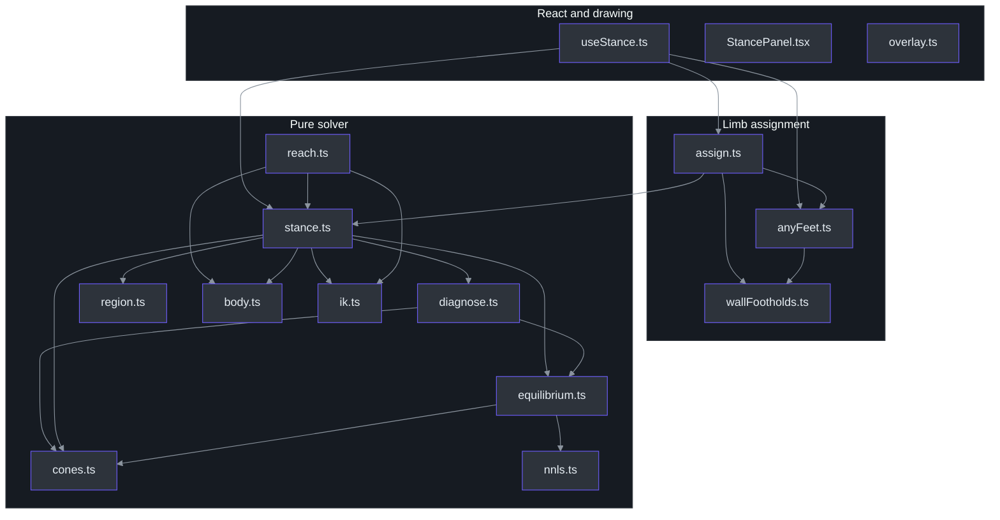
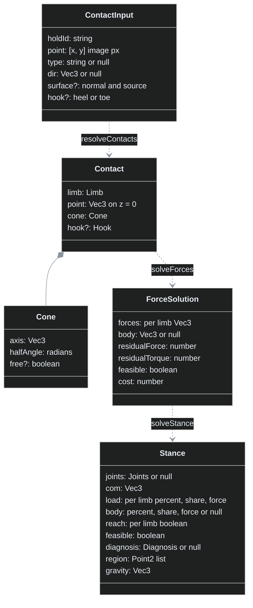
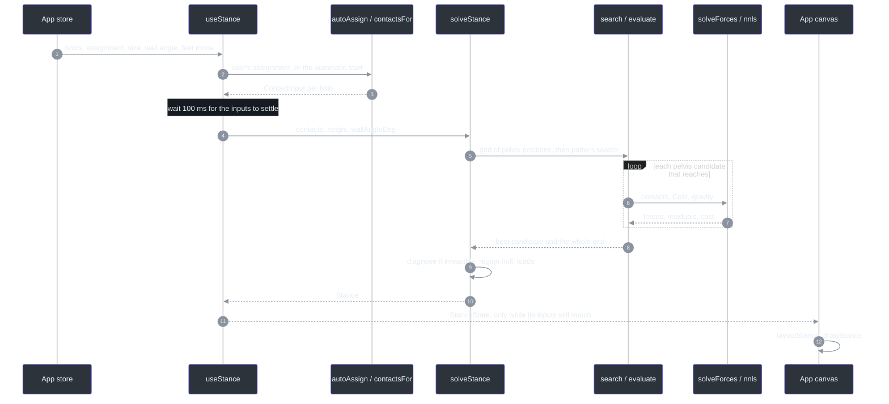
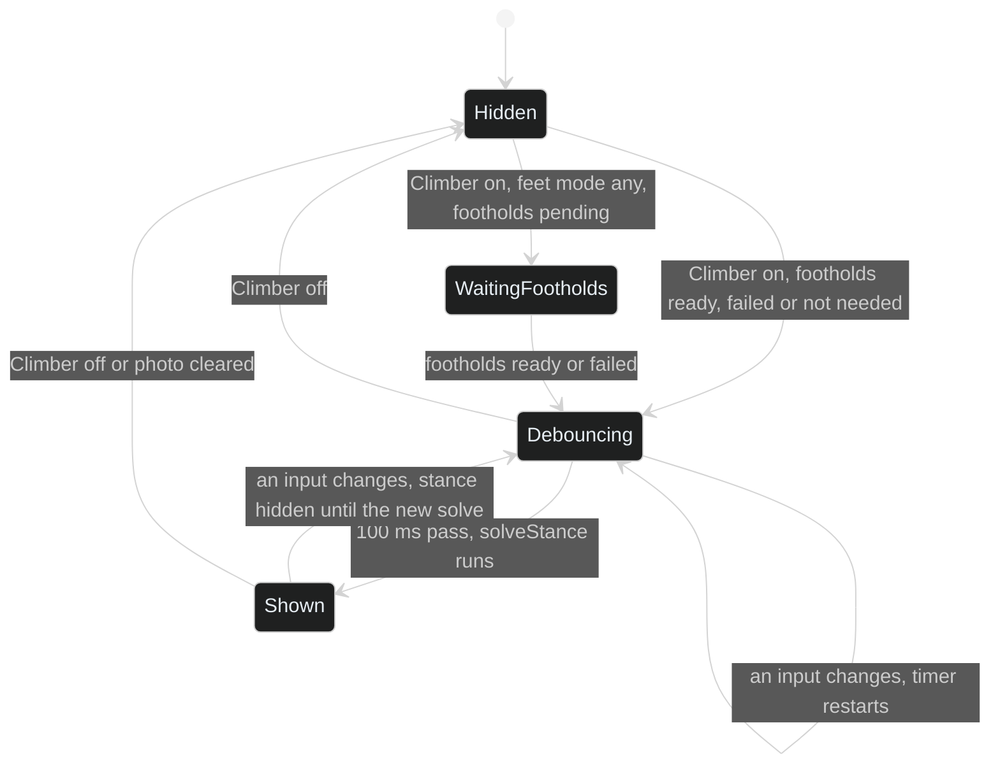
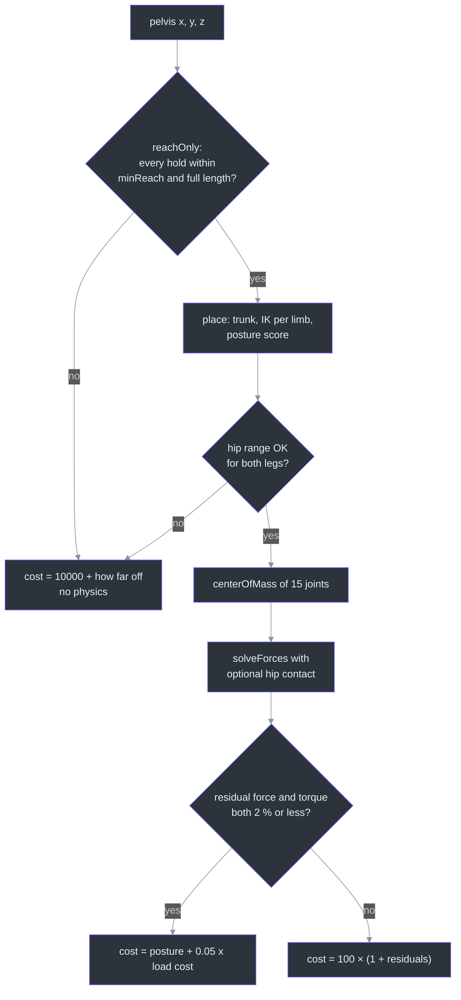
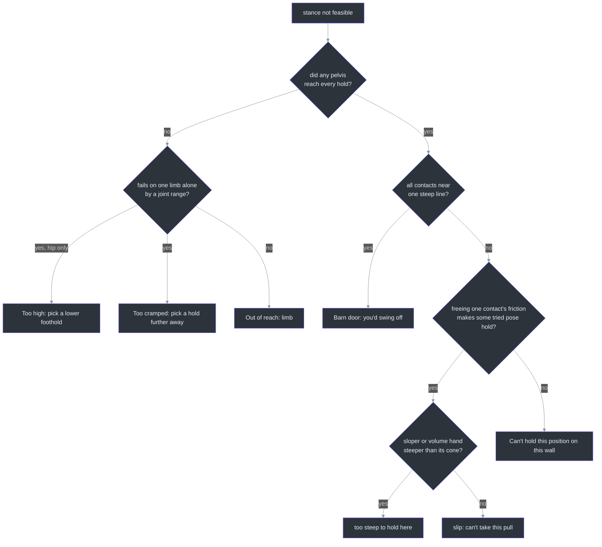

# Climber Stance: the balance solver

Checked against `main` at
[`29aca10`](https://github.com/r03922123/bouldering-vis/tree/29aca10) on 2026-11-12. Every link
below points at that commit, so a citation never drifts. Where this page and
[SPEC-climber-stance.md](../../SPEC-climber-stance.md) disagree, this page describes the code, and
the disagreement is listed under [SPEC drift](#spec-drift).

## Overview: why this module exists

A route is a set of holds, but a climber learns from a **body on those holds**: where the hips
go, how much each hand carries, and why a position fails. `climber-stance` turns the holds a user
tagged into one frozen position (a **stance**) and answers three questions about it
([SPEC-climber-stance.md:14-17](https://github.com/r03922123/bouldering-vis/blob/29aca10/SPEC-climber-stance.md#L14-L17)):

| Question | Answer in the code | Source |
|---|---|---|
| Where does the body go? | A pelvis search plus two-bone IK places 15 joints | [stance.ts:385-445](https://github.com/r03922123/bouldering-vis/blob/29aca10/src/modules/climber-stance/stance.ts#L385-L445) |
| How much weight does each limb carry? | Contact forces from a small least-squares problem (NNLS) | [equilibrium.ts:80-160](https://github.com/r03922123/bouldering-vis/blob/29aca10/src/modules/climber-stance/equilibrium.ts#L80-L160) |
| Why can't it be held? | The first rule that applies: reach, barn door, slip, unbalanced | [diagnose.ts:171-251](https://github.com/r03922123/bouldering-vis/blob/29aca10/src/modules/climber-stance/diagnose.ts#L171-L251) |

**First principles.** A climber who isn't moving is in **quasi-static equilibrium**: the forces
the holds push back with must cancel the body's weight, and their turning effects (torques) about
the center of mass (**CoM**) must cancel too. Each hold can only push back in a limited set of
directions, its **friction cone**: a jug resists a pull from almost any downward angle, a sloper
only a narrow one. So "can this be held?" becomes "is there a set of forces, each inside its cone,
that balances the weight?" (SPEC decision S1,
[SPEC-climber-stance.md:33](https://github.com/r03922123/bouldering-vis/blob/29aca10/SPEC-climber-stance.md#L33)).
That question is a linear feasibility problem, which is why the whole module runs in pure
TypeScript on the main thread with no physics engine and no dependency.

**This is a teaching picture, not a measurement**
([SPEC-climber-stance.md:17](https://github.com/r03922123/bouldering-vis/blob/29aca10/SPEC-climber-stance.md#L17)).
Forces are in **% of bodyweight** and lengths in **image pixels** (S2), so the climber's height on
the photo is the only scale input.

## Architecture

### At a glance

| Layer | Files | Pure? | Source |
|---|---|---|---|
| Public entry | `index.ts`, plus `worker.ts` for the ML worker | `worker.ts` only; `index.ts` re-exports the React parts too | [index.ts:1-62](https://github.com/r03922123/bouldering-vis/blob/29aca10/src/modules/climber-stance/index.ts#L1-L62), [worker.ts:1-2](https://github.com/r03922123/bouldering-vis/blob/29aca10/src/modules/climber-stance/worker.ts#L1-L2) |
| Which limb on which hold | `assign.ts`, `anyFeet.ts`, `wallFootholds.ts` | yes | [assign.ts:56-87](https://github.com/r03922123/bouldering-vis/blob/29aca10/src/modules/climber-stance/assign.ts#L56-L87) |
| Body and reach | `body.ts`, `ik.ts`, `reach.ts` | yes | [body.ts:68-82](https://github.com/r03922123/bouldering-vis/blob/29aca10/src/modules/climber-stance/body.ts#L68-L82) |
| Physics | `cones.ts`, `equilibrium.ts`, `nnls.ts`, `vec.ts` | yes | [equilibrium.ts:80](https://github.com/r03922123/bouldering-vis/blob/29aca10/src/modules/climber-stance/equilibrium.ts#L80) |
| Pose search and result | `stance.ts`, `region.ts`, `diagnose.ts`, `shares.ts` | yes | [stance.ts:454](https://github.com/r03922123/bouldering-vis/blob/29aca10/src/modules/climber-stance/stance.ts#L454) |
| React and drawing | `useStance.ts`, `useWallFootholds.ts`, `overlay.ts`, `StancePanel.tsx` | no | [useStance.ts:31](https://github.com/r03922123/bouldering-vis/blob/29aca10/src/modules/climber-stance/useStance.ts#L31) |

The comment on `stance.ts` states the contract the rest relies on: "the same contacts and options
give the same stance"
([stance.ts:10](https://github.com/r03922123/bouldering-vis/blob/29aca10/src/modules/climber-stance/stance.ts#L10)).
`beta-moves` leans on that purity to cache solves
([beta-moves/cache.ts:91](https://github.com/r03922123/bouldering-vis/blob/29aca10/src/modules/beta-moves/cache.ts#L91)).

### File dependencies


<!-- Sources: src/modules/climber-stance/useStance.ts:1-6, src/modules/climber-stance/assign.ts:1-7, src/modules/climber-stance/anyFeet.ts:1-6, src/modules/climber-stance/stance.ts:1-8, src/modules/climber-stance/equilibrium.ts:1-4, src/modules/climber-stance/diagnose.ts:1-6, src/modules/climber-stance/reach.ts:1-14 -->

### Who calls it

| Caller | What it uses | Source |
|---|---|---|
| Setting Room (`App`) | `useStance`, `layoutStance`, `drawStance`, `StancePanel` | [App.tsx:56](https://github.com/r03922123/bouldering-vis/blob/29aca10/src/app/App.tsx#L56), [App.tsx:66-68](https://github.com/r03922123/bouldering-vis/blob/29aca10/src/app/App.tsx#L66-L68), [App.tsx:148](https://github.com/r03922123/bouldering-vis/blob/29aca10/src/app/App.tsx#L148) |
| 3D view | `layoutStance` with a three.js projection | [PointCloudView.tsx:250](https://github.com/r03922123/bouldering-vis/blob/29aca10/src/modules/point-cloud-view/PointCloudView.tsx#L250) |
| Play's referee (`beta-moves`) | `solveStance` with `region: false`, `reachRatios` | [beta-moves/cache.ts:91](https://github.com/r03922123/bouldering-vis/blob/29aca10/src/modules/beta-moves/cache.ts#L91), [beta-moves/cache.ts:119](https://github.com/r03922123/bouldering-vis/blob/29aca10/src/modules/beta-moves/cache.ts#L119) |
| App store | the user's choices: assignment, hooks, size, wall angle, feet mode | [store/app.ts:54-67](https://github.com/r03922123/bouldering-vis/blob/29aca10/src/store/app.ts#L54-L67) |

## Components

### The core types


<!-- Sources: src/modules/climber-stance/stance.ts:12-27, src/modules/climber-stance/equilibrium.ts:9-15, src/modules/climber-stance/cones.ts:8-14, src/modules/climber-stance/equilibrium.ts:40-52, src/modules/climber-stance/stance.ts:69-91, src/modules/climber-stance/stance.ts:349-368 -->

| Type | Role | Source |
|---|---|---|
| `Limb` | `'lh' \| 'rh' \| 'lf' \| 'rf'` | [types.ts:3](https://github.com/r03922123/bouldering-vis/blob/29aca10/src/modules/climber-stance/types.ts#L3) |
| `ContactInput` | One limb's hold, as the app knows it (2D point, type, pull) | [stance.ts:12-27](https://github.com/r03922123/bouldering-vis/blob/29aca10/src/modules/climber-stance/stance.ts#L12-L27) |
| `Contact` | The same contact in 3D, with its friction cone | [equilibrium.ts:9-15](https://github.com/r03922123/bouldering-vis/blob/29aca10/src/modules/climber-stance/equilibrium.ts#L9-L15) |
| `PosturePrior` | What a natural stance looks like, with no physics | [stance.ts:46-67](https://github.com/r03922123/bouldering-vis/blob/29aca10/src/modules/climber-stance/stance.ts#L46-L67) |
| `Stance` | The result: joints, CoM, loads, region, diagnosis | [stance.ts:69-91](https://github.com/r03922123/bouldering-vis/blob/29aca10/src/modules/climber-stance/stance.ts#L69-L91) |
| `Diagnosis` | Why it fails, with a Studio text and an optional Play text | [diagnose.ts:12-28](https://github.com/r03922123/bouldering-vis/blob/29aca10/src/modules/climber-stance/diagnose.ts#L12-L28) |

### The wall frame

All 3D math uses one frame: **+x right, +y down the wall, +z out of the wall**
([vec.ts:1](https://github.com/r03922123/bouldering-vis/blob/29aca10/src/modules/climber-stance/vec.ts#L1)).
Holds sit on the wall plane at z = 0
([stance.ts:359](https://github.com/r03922123/bouldering-vis/blob/29aca10/src/modules/climber-stance/stance.ts#L359)).
The wall's steepness is not measured from the photo; the user picks it (S4), and it only tilts
gravity:

```ts
// stance.ts:94-97 — overhang > 0 tips gravity out of the wall (+z)
gravityFor(a) = [0, cos(a), sin(a)]
```

| Wall | Angle | Gravity | Source |
|---|---|---|---|
| Slab | −10° | slightly into the wall | [types.ts:17-23](https://github.com/r03922123/bouldering-vis/blob/29aca10/src/modules/climber-stance/types.ts#L17-L23) |
| Vertical | 0° | straight down the wall | same |
| Overhang | 20°, 35°, 45° | down and off the wall | same |

hold-geometry measures each hold's pull in the *local* depth frame. `contactsFor` rotates it into
the wall frame with Rodrigues' formula (`alignToOut`), so a depth tilt around one hold doesn't
tip its cone
([assign.ts:116-122](https://github.com/r03922123/bouldering-vis/blob/29aca10/src/modules/climber-stance/assign.ts#L116-L122),
[vec.ts:28-36](https://github.com/r03922123/bouldering-vis/blob/29aca10/src/modules/climber-stance/vec.ts#L28-L36)).

### The body

A stick skeleton of 15 joints. Segment **lengths** are Winter's ratios × height; segment
**masses** and **CoM positions** are de Leva 1996, the mean of the male and female tables
([body.ts:3-5](https://github.com/r03922123/bouldering-vis/blob/29aca10/src/modules/climber-stance/body.ts#L3-L5)).

| Segment | Length (× H) | Mass (× body) | Source |
|---|---|---|---|
| Upper arm | 0.186 | 0.0263 | [body.ts:72](https://github.com/r03922123/bouldering-vis/blob/29aca10/src/modules/climber-stance/body.ts#L72), [body.ts:30](https://github.com/r03922123/bouldering-vis/blob/29aca10/src/modules/climber-stance/body.ts#L30) |
| Forearm to grip | 0.200 | 0.015 (+ hand 0.00585) | [body.ts:73](https://github.com/r03922123/bouldering-vis/blob/29aca10/src/modules/climber-stance/body.ts#L73), [body.ts:31-32](https://github.com/r03922123/bouldering-vis/blob/29aca10/src/modules/climber-stance/body.ts#L31-L32) |
| Thigh | 0.245 | 0.1447 | [body.ts:74](https://github.com/r03922123/bouldering-vis/blob/29aca10/src/modules/climber-stance/body.ts#L74), [body.ts:33](https://github.com/r03922123/bouldering-vis/blob/29aca10/src/modules/climber-stance/body.ts#L33) |
| Knee to toe | 0.285 | 0.0457 (+ foot 0.0133) | [body.ts:75](https://github.com/r03922123/bouldering-vis/blob/29aca10/src/modules/climber-stance/body.ts#L75), [body.ts:34-35](https://github.com/r03922123/bouldering-vis/blob/29aca10/src/modules/climber-stance/body.ts#L34-L35) |
| Trunk (hip to shoulder) | 0.288 | 0.43015 (+ head 0.0681) | [body.ts:76](https://github.com/r03922123/bouldering-vis/blob/29aca10/src/modules/climber-stance/body.ts#L76), [body.ts:28-29](https://github.com/r03922123/bouldering-vis/blob/29aca10/src/modules/climber-stance/body.ts#L28-L29) |

`centerOfMass` is the mass-weighted mean of each segment's CoM point
([body.ts:85-103](https://github.com/r03922123/bouldering-vis/blob/29aca10/src/modules/climber-stance/body.ts#L85-L103)).
The climber faces the wall with its back to the camera, which fixes which side is "right"
([body.ts:105-106](https://github.com/r03922123/bouldering-vis/blob/29aca10/src/modules/climber-stance/body.ts#L105-L106)).

The default climber is **0.26 × the photo's width**, clamped to 0.12–0.6 × its height, or 170 cm
when a sample photo carries a measured px-per-cm scale
([assign.ts:95-114](https://github.com/r03922123/bouldering-vis/blob/29aca10/src/modules/climber-stance/assign.ts#L95-L114)).
The store's `climberScale` multiplies it
([useStance.ts:53](https://github.com/r03922123/bouldering-vis/blob/29aca10/src/modules/climber-stance/useStance.ts#L53)).

### Reach: two-bone IK

Each limb is two bones (shoulder → elbow → hand, hip → knee → toe), so the middle joint has a
closed-form position: the law of cosines gives how far along the root-to-target line it sits, and
a **pole vector** picks which way it bends
([ik.ts:60-83](https://github.com/r03922123/bouldering-vis/blob/29aca10/src/modules/climber-stance/ik.ts#L60-L83)).
A limb fails to reach in three ways:

| Failure | Test | Diagnosis words | Source |
|---|---|---|---|
| Too far | distance > upper + lower bone | "Out of reach" | [ik.ts:72-76](https://github.com/r03922123/bouldering-vis/blob/29aca10/src/modules/climber-stance/ik.ts#L72-L76) |
| Too close | distance < `minReach` (the elbow folds ≤ 145°, the knee ≤ 140°) | "Too cramped" | [ik.ts:13-23](https://github.com/r03922123/bouldering-vis/blob/29aca10/src/modules/climber-stance/ik.ts#L13-L23) |
| Foot too high | thigh > 130° from the trunk's down line | "Too high" | [ik.ts:31-39](https://github.com/r03922123/bouldering-vis/blob/29aca10/src/modules/climber-stance/ik.ts#L31-L39), [stance.ts:251-253](https://github.com/r03922123/bouldering-vis/blob/29aca10/src/modules/climber-stance/stance.ts#L251-L253) |

The joint ranges come from the CDC range-of-motion study, adults 20–44
([ik.ts:7-13](https://github.com/r03922123/bouldering-vis/blob/29aca10/src/modules/climber-stance/ik.ts#L7-L13)).

### Friction cones

A cone is an **axis** (the direction the hold pushes back) and a **half-angle** (how far the push
may tilt before the hand slips). For a hand with a known pull `dir`, the axis is `−dir`, because
the hold pushes back against the pull
([cones.ts:5-6](https://github.com/r03922123/bouldering-vis/blob/29aca10/src/modules/climber-stance/cones.ts#L5-L6),
[cones.ts:69](https://github.com/r03922123/bouldering-vis/blob/29aca10/src/modules/climber-stance/cones.ts#L69)).

| Contact | Axis | Half-angle | Source |
|---|---|---|---|
| Hand on a jug | −pull | 55° | [cones.ts:29-37](https://github.com/r03922123/bouldering-vis/blob/29aca10/src/modules/climber-stance/cones.ts#L29-L37) |
| Hand on a pocket / edge / crimp | −pull | 45° / 40° / 35° | same |
| Hand on a pinch | −pull, or up | 60° | [cones.ts:26-27](https://github.com/r03922123/bouldering-vis/blob/29aca10/src/modules/climber-stance/cones.ts#L26-L27) |
| Hand on a sloper or volume, with a grip surface | the grip surface's outward normal | atan(0.72) ≈ 35.75° | [cones.ts:22-24](https://github.com/r03922123/bouldering-vis/blob/29aca10/src/modules/climber-stance/cones.ts#L22-L24), [cones.ts:65-67](https://github.com/r03922123/bouldering-vis/blob/29aca10/src/modules/climber-stance/cones.ts#L65-L67) |
| Hand with no pull (any type but pinch) | up | 40° | [cones.ts:38-39](https://github.com/r03922123/bouldering-vis/blob/29aca10/src/modules/climber-stance/cones.ts#L38-L39), [cones.ts:68](https://github.com/r03922123/bouldering-vis/blob/29aca10/src/modules/climber-stance/cones.ts#L68) |
| Hand with a pull, unknown type | −pull | 40° | [cones.ts:69](https://github.com/r03922123/bouldering-vis/blob/29aca10/src/modules/climber-stance/cones.ts#L69) |
| Foot on any hold | up and out, unit(0, −1, 0.6) | 45° | [cones.ts:40-41](https://github.com/r03922123/bouldering-vis/blob/29aca10/src/modules/climber-stance/cones.ts#L40-L41) |
| Foot smearing the bare wall | straight out of the wall | 35° | [cones.ts:42](https://github.com/r03922123/bouldering-vis/blob/29aca10/src/modules/climber-stance/cones.ts#L42), [cones.ts:60-63](https://github.com/r03922123/bouldering-vis/blob/29aca10/src/modules/climber-stance/cones.ts#L60-L63) |
| Heel hook / toe hook | the hand cone's axis / toward the far side and the wall | 45° / 40° | [cones.ts:80-98](https://github.com/r03922123/bouldering-vis/blob/29aca10/src/modules/climber-stance/cones.ts#L80-L98) |
| Hips on the wall (both feet off) | straight out of the wall | 20° | [cones.ts:100-104](https://github.com/r03922123/bouldering-vis/blob/29aca10/src/modules/climber-stance/cones.ts#L100-L104) |

A round cone isn't linear, so `coneEdges` replaces it with an **8-edge pyramid** inscribed in it
(S9). A force inside the pyramid is any non-negative mix of its 8 edge vectors
([cones.ts:106-129](https://github.com/r03922123/bouldering-vis/blob/29aca10/src/modules/climber-stance/cones.ts#L106-L129)).
A cone marked `free` gets the 6 axis directions instead, so it can push or pull any way; the
diagnosis uses that to ask "would it hold if this one contact couldn't slip?"
([cones.ts:119](https://github.com/r03922123/bouldering-vis/blob/29aca10/src/modules/climber-stance/cones.ts#L119)).

## Data flow

### From a store change to a drawn climber


<!-- Sources: src/modules/climber-stance/useStance.ts:31-130, src/modules/climber-stance/stance.ts:454-535, src/modules/climber-stance/stance.ts:385-445, src/modules/climber-stance/equilibrium.ts:80-160, src/app/App.tsx:56-68 -->

| Step | What happens | Source |
|---|---|---|
| 1–3 | The user's assignment wins; otherwise `autoAssign` picks the start holds for the hands and ranks footholds for the feet | [useStance.ts:54-57](https://github.com/r03922123/bouldering-vis/blob/29aca10/src/modules/climber-stance/useStance.ts#L54-L57), [assign.ts:56-87](https://github.com/r03922123/bouldering-vis/blob/29aca10/src/modules/climber-stance/assign.ts#L56-L87) |
| 4 | A dragged slider sends many changes, so the solve waits `STANCE_DEBOUNCE_MS` = 100 ms | [useStance.ts:8-9](https://github.com/r03922123/bouldering-vis/blob/29aca10/src/modules/climber-stance/useStance.ts#L8-L9), [useStance.ts:99-113](https://github.com/r03922123/bouldering-vis/blob/29aca10/src/modules/climber-stance/useStance.ts#L99-L113) |
| 5–10 | The pure solve (next section) | [stance.ts:454-535](https://github.com/r03922123/bouldering-vis/blob/29aca10/src/modules/climber-stance/stance.ts#L454-L535) |
| 11 | A stance is shown only while photo, contacts, height and wall angle still equal what it was solved for | [useStance.ts:115-124](https://github.com/r03922123/bouldering-vis/blob/29aca10/src/modules/climber-stance/useStance.ts#L115-L124) |

### The hook's states

`useStance` returns `stance: null` in every state but the last, so a canvas never draws old
joints against new holds.


<!-- Sources: src/modules/climber-stance/useStance.ts:48-51, src/modules/climber-stance/useStance.ts:99-113, src/modules/climber-stance/useStance.ts:115-124 -->

Wall footholds are blobs of the wall mask, computed in the ML worker through `worker.ts`. In
`'any'` feet mode nothing is solved until they arrive, "so a smear stance never flashes before the
real feet"; if they fail, the solve runs without them
([useStance.ts:48-51](https://github.com/r03922123/bouldering-vis/blob/29aca10/src/modules/climber-stance/useStance.ts#L48-L51)).

## Implementation

### `solveStance` in four stages

```ts
// Pseudocode of stance.ts:454-535
function solveStance(input, { height: H, wallAngleDeg, prior, region }) {
  const contacts = resolveContacts(input);          // 2D holds → 3D contacts with cones
  if (contacts.length === 0) return emptyStance("Put a hand or foot on a hold");
  const { best, grid } = search(contacts, ...);     // pick the pelvis
  const feasible = best.sol?.feasible ?? false;
  const diagnosis = feasible ? null : diagnose(...);
  const shown = feasible ? best : natural(grid);    // a failing stance gets a natural pose
  const load = feasible ? sharesOf(best.sol) : {};  // no numbers for an impossible position
  const hull = region !== false && best.sol ? feasibleRegion(...) : [];  // no region if nothing reached
  return { joints, com, load, body, reach, feasible, diagnosis, region: hull, gravity };
}
```

### Stage 1: the pelvis search

The only unknown is the **pelvis position (x, y, z)**. Once it is fixed, the trunk follows
(`trunkDirection` leans it 25 % from straight up toward the hands), and IK places every limb on
its hold. So the search is over 3 numbers
([stance.ts:176-189](https://github.com/r03922123/bouldering-vis/blob/29aca10/src/modules/climber-stance/stance.ts#L176-L189),
[stance.ts:118-129](https://github.com/r03922123/bouldering-vis/blob/29aca10/src/modules/climber-stance/stance.ts#L118-L129)).

| Setting | Value | Source |
|---|---|---|
| Grid step in x and y | 0.06 H | [stance.ts:109](https://github.com/r03922123/bouldering-vis/blob/29aca10/src/modules/climber-stance/stance.ts#L109) |
| Depths tried (z) | 0.10, 0.17, 0.24, 0.31, 0.38 H | [stance.ts:110](https://github.com/r03922123/bouldering-vis/blob/29aca10/src/modules/climber-stance/stance.ts#L110) |
| Box | holds ± 0.5 H sideways, up to 0.6 H below; top = `hipFloor` | [stance.ts:392-402](https://github.com/r03922123/bouldering-vis/blob/29aca10/src/modules/climber-stance/stance.ts#L392-L402) |
| Hip floor | 0.15 H below the highest hand (no mantles) | [stance.ts:376-382](https://github.com/r03922123/bouldering-vis/blob/29aca10/src/modules/climber-stance/stance.ts#L376-L382) |
| Refinement | ±x, ±y, ±z steps from 0.5 × grid step, halved until 0.003 H; z clamped to 0.08–0.45 H | [stance.ts:421-442](https://github.com/r03922123/bouldering-vis/blob/29aca10/src/modules/climber-stance/stance.ts#L421-L442) |
| Tie-break (grid only) | costs within 1e-9 are a tie; the pelvis further left wins. The refinement takes strict improvements only | [stance.ts:164-174](https://github.com/r03922123/bouldering-vis/blob/29aca10/src/modules/climber-stance/stance.ts#L164-L174) |

The grid is centred on the holds' mean x, so mirrored holds get a mirrored grid and a mirrored
answer
([stance.ts:407-409](https://github.com/r03922123/bouldering-vis/blob/29aca10/src/modules/climber-stance/stance.ts#L407-L409)).
`hipFloor` is exported because `beta-moves` uses the same rule for its reach check, "so the
referee's reach and stance checks can't disagree"
([stance.ts:370-375](https://github.com/r03922123/bouldering-vis/blob/29aca10/src/modules/climber-stance/stance.ts#L370-L375)).

### Stage 2: scoring one pelvis position

`evaluate` is called for every grid point and every refinement step, so it does the cheap test
first.


<!-- Sources: src/modules/climber-stance/stance.ts:274-292, src/modules/climber-stance/stance.ts:294-340, src/modules/climber-stance/stance.ts:140-143, src/modules/climber-stance/equilibrium.ts:150-158 -->

The three cost bands keep the order right without any special casing: any reachable pose
(≥ 100 only when infeasible) beats any unreachable one (≥ 10 000), and any feasible pose beats any
infeasible one
([stance.ts:140-143](https://github.com/r03922123/bouldering-vis/blob/29aca10/src/modules/climber-stance/stance.ts#L140-L143)).
The unreachable band adds "how far off" so the pattern search still has a slope to follow
([stance.ts:315-316](https://github.com/r03922123/bouldering-vis/blob/29aca10/src/modules/climber-stance/stance.ts#L315-L316)).

**Why the pose comes from a posture prior, not from the forces.** An earlier version chose the
pose that minimised the load cost, and "made every vertical 4-point stance split 17/17/33/33
(just the cost weights), whatever the feet did"
([stance.ts:113-117](https://github.com/r03922123/bouldering-vis/blob/29aca10/src/modules/climber-stance/stance.ts#L113-L117)).
Now `place` scores how natural the pose looks, and the load cost (weight 0.05) only nudges the pose
([stance.ts:336-338](https://github.com/r03922123/bouldering-vis/blob/29aca10/src/modules/climber-stance/stance.ts#L336-L338)):

| Posture term | Target | Source |
|---|---|---|
| Arm reach | near 0.8 of full length (bent arms) | [stance.ts:265-268](https://github.com/r03922123/bouldering-vis/blob/29aca10/src/modules/climber-stance/stance.ts#L265-L268) |
| Loaded leg | 0.97–1.0 (near-straight); a high step, a hook or an unloaded smear may bend to 0.45 | [stance.ts:130-131](https://github.com/r03922123/bouldering-vis/blob/29aca10/src/modules/climber-stance/stance.ts#L130-L131), [stance.ts:261-264](https://github.com/r03922123/bouldering-vis/blob/29aca10/src/modules/climber-stance/stance.ts#L261-L264) |
| Hip depth | 0.10 H off the wall, steep penalty past 0.15 H | [stance.ts:224-227](https://github.com/r03922123/bouldering-vis/blob/29aca10/src/modules/climber-stance/stance.ts#L224-L227) |
| Over the feet | pelvis x near the feet's mean x | [stance.ts:233-236](https://github.com/r03922123/bouldering-vis/blob/29aca10/src/modules/climber-stance/stance.ts#L233-L236) |

### Stage 3: the forces (equilibrium as NNLS)

With the pose fixed, `solveForces` looks for one non-negative weight per pyramid edge. Let `x` be
those weights. It builds one stacked least-squares problem
([equilibrium.ts:99-131](https://github.com/r03922123/bouldering-vis/blob/29aca10/src/modules/climber-stance/equilibrium.ts#L99-L131)):

| Rows | Equation | Weight | Why |
|---|---|---|---|
| 3 force rows | Σ f = −g | √10⁴ = 100 | Balance must win over preference |
| 3 torque rows | Σ (p − c) × f / H = 0 | 100 | Divided by height to share the force rows' units |
| 3 rows per contact | √w · f | w = 2 for a hand, 1 for a foot; sideways (x) × 4 | "Weight on your feet", and climbers shift onto the foot under them rather than lean on sideways friction |

Constants:
[equilibrium.ts:54-66](https://github.com/r03922123/bouldering-vis/blob/29aca10/src/modules/climber-stance/equilibrium.ts#L54-L66).
Minimising ‖Ax − b‖² with x ≥ 0 then gives the least-effort forces that (nearly) balance. Because
the balance rows can't always reach zero, feasibility is checked afterwards: residual force and
residual torque must both be ≤ 0.02 bodyweight (S11,
[equilibrium.ts:150-158](https://github.com/r03922123/bouldering-vis/blob/29aca10/src/modules/climber-stance/equilibrium.ts#L150-L158)).

With both feet off and the pelvis within 0.10 H of the wall, the hips rest on the wall as one more
contact, weighted as a foot
([equilibrium.ts:23-38](https://github.com/r03922123/bouldering-vis/blob/29aca10/src/modules/climber-stance/equilibrium.ts#L23-L38),
[equilibrium.ts:96](https://github.com/r03922123/bouldering-vis/blob/29aca10/src/modules/climber-stance/equilibrium.ts#L96)).

**The NNLS solver** is Lawson–Hanson's active-set method in ~110 lines, with no dependency
([nnls.ts:1-2](https://github.com/r03922123/bouldering-vis/blob/29aca10/src/modules/climber-stance/nnls.ts#L1-L2)):

```ts
// Pseudocode of nnls.ts:46-112
M = AᵀA; v = Aᵀb                     // built once; problems have ≤ 32 columns
x = 0; passive = {}                  // passive = columns allowed to be > 0
repeat up to 3n times:
  j = column outside passive with the largest gradient (v − M x)[j] > tol
  if none: stop                      // optimal: no column can lower the error
  add j to passive
  repeat:
    s = solve M[P,P] s = v[P]        // unconstrained least squares on the passive set
    if singular: drop j for good; break
    if all s > tol: x[P] = s; break
    step x toward s until the first column hits 0; drop every column now at 0
return x
```

Two details protect against a hang or a crash on degenerate input: a column whose sub-problem is
singular is `blocked` and never tried again, and both loops stop after `3n` passes
([nnls.ts:63-64](https://github.com/r03922123/bouldering-vis/blob/29aca10/src/modules/climber-stance/nnls.ts#L63-L64),
[nnls.ts:73](https://github.com/r03922123/bouldering-vis/blob/29aca10/src/modules/climber-stance/nnls.ts#L73),
[nnls.ts:86-91](https://github.com/r03922123/bouldering-vis/blob/29aca10/src/modules/climber-stance/nnls.ts#L86-L91)).

**From forces to the numbers on screen.** The solver's forces are what each hold puts on the
climber; the panel shows the opposite, what the limb applies to the hold. `percent` is its size,
and `share` its part along gravity, so the shares add up to 100 and an undercling's is negative
([stance.ts:489-505](https://github.com/r03922123/bouldering-vis/blob/29aca10/src/modules/climber-stance/stance.ts#L489-L505)).
`roundShares` rounds them with the largest-remainder method, so the panel's rows read 100 %
together (up to the solve's 2 % tolerance)
([shares.ts:3-23](https://github.com/r03922123/bouldering-vis/blob/29aca10/src/modules/climber-stance/shares.ts#L3-L23)).

> **Honest limit (SPEC S10).** On a vertical wall the hand-versus-foot split is statically
> indeterminate: many force sets balance. The 2 : 1 hand/foot weights pick one, so that split
> teaches the "weight on your feet" rule rather than measuring it. The left/right split, and any
> split where a cone limits, does come from the geometry
> ([SPEC-climber-stance.md:42](https://github.com/r03922123/bouldering-vis/blob/29aca10/SPEC-climber-stance.md#L42)).

### Stage 4: "where your hips can be"

For fixed contacts, the set of CoM positions that can be balanced is convex (Bretl & Lall 2008).
So `feasibleRegion` samples an 18 × 18 grid of CoM positions on the wall plane, keeps those
`solveForces` accepts, and draws their convex hull (Andrew's monotone chain)
([region.ts:1-2](https://github.com/r03922123/bouldering-vis/blob/29aca10/src/modules/climber-stance/region.ts#L1-L2),
[region.ts:25-45](https://github.com/r03922123/bouldering-vis/blob/29aca10/src/modules/climber-stance/region.ts#L25-L45),
[stance.ts:507-523](https://github.com/r03922123/bouldering-vis/blob/29aca10/src/modules/climber-stance/stance.ts#L507-L523)).
That is up to 324 extra force solves; the SPEC names it as the next thing to speed up (see Performance). `beta-moves` skips it with
`region: false`
([stance.ts:38-39](https://github.com/r03922123/bouldering-vis/blob/29aca10/src/modules/climber-stance/stance.ts#L38-L39)).

### Diagnosis: the first rule that applies


<!-- Sources: src/modules/climber-stance/diagnose.ts:171-251, src/modules/climber-stance/diagnose.ts:131-169, src/modules/climber-stance/diagnose.ts:59-68 -->

| Rule | How it is decided | Source |
|---|---|---|
| Reach | The limb that alone blocks the most grid positions | [diagnose.ts:131-145](https://github.com/r03922123/bouldering-vis/blob/29aca10/src/modules/climber-stance/diagnose.ts#L131-L145), [diagnose.ts:181-204](https://github.com/r03922123/bouldering-vis/blob/29aca10/src/modules/climber-stance/diagnose.ts#L181-L204) |
| Barn door | A principal-axis line fit; every contact within 0.08 H of it, and the line steeper than 30° from horizontal | [diagnose.ts:147-169](https://github.com/r03922123/bouldering-vis/blob/29aca10/src/modules/climber-stance/diagnose.ts#L147-L169) |
| Slip | Free each contact's cone in turn; count feasible poses among the best 40 and every 4th reachable one; the most hits wins | [diagnose.ts:30-33](https://github.com/r03922123/bouldering-vis/blob/29aca10/src/modules/climber-stance/diagnose.ts#L30-L33), [diagnose.ts:216-235](https://github.com/r03922123/bouldering-vis/blob/29aca10/src/modules/climber-stance/diagnose.ts#L216-L235) |
| Too steep | The grip surface is tilted further from true up than 35.75°, so the same sloper is steeper on an overhang | [diagnose.ts:59-68](https://github.com/r03922123/bouldering-vis/blob/29aca10/src/modules/climber-stance/diagnose.ts#L59-L68) |

**Why barn door is checked before slips:** freeing a contact lets it pull in any direction,
which "explains" almost any one-sided stance as a slip
([diagnose.ts:206-207](https://github.com/r03922123/bouldering-vis/blob/29aca10/src/modules/climber-stance/diagnose.ts#L206-L207)).
Each diagnosis carries the Studio's words, plus Play's words where the Studio's advice names a
control Play doesn't have, such as the climber-size slider
([diagnose.ts:15-22](https://github.com/r03922123/bouldering-vis/blob/29aca10/src/modules/climber-stance/diagnose.ts#L15-L22)).

A stance that can't be held is drawn in its most natural reachable pose (posture only, no
physics), because the search's least-bad pose "is often a strange mantle"
([stance.ts:447-452](https://github.com/r03922123/bouldering-vis/blob/29aca10/src/modules/climber-stance/stance.ts#L447-L452),
[stance.ts:482-484](https://github.com/r03922123/bouldering-vis/blob/29aca10/src/modules/climber-stance/stance.ts#L482-L484)).

### Performance

| Measure | Budget | Measured | Source |
|---|---|---|---|
| Longest main-thread task, desktop | < 60 ms | 51–59 ms | [SPEC-climber-stance.md:157](https://github.com/r03922123/bouldering-vis/blob/29aca10/SPEC-climber-stance.md#L157), [SPEC-climber-stance.md:197](https://github.com/r03922123/bouldering-vis/blob/29aca10/SPEC-climber-stance.md#L197) |
| Same, 4× CPU throttle | < 150 ms | 110–117 ms | same |

Desktop is close to its budget. The SPEC names the next speed-up: bisect the CoM range instead of
sampling the 18 × 18 region grid. Small helpers keep the hot loop cheap: pyramid edges are cached
per cone object
([equilibrium.ts:68-74](https://github.com/r03922123/bouldering-vis/blob/29aca10/src/modules/climber-stance/equilibrium.ts#L68-L74)),
and `reachOnly` rejects a pelvis by distance alone before any IK or force solve
([stance.ts:274-292](https://github.com/r03922123/bouldering-vis/blob/29aca10/src/modules/climber-stance/stance.ts#L274-L292)).

### SPEC drift

Found while writing this page; the code was amended after the SPEC's decisions table, and the
amendments further down the SPEC may already explain each one (inference, not checked line by
line).

| SPEC says | Code does | Source |
|---|---|---|
| S8: trunk leans "halfway" toward the hands | `lean: 0.25` | [SPEC-climber-stance.md:40](https://github.com/r03922123/bouldering-vis/blob/29aca10/SPEC-climber-stance.md#L40), [stance.ts:127](https://github.com/r03922123/bouldering-vis/blob/29aca10/src/modules/climber-stance/stance.ts#L127) |
| S10: arms near 90 % reach, legs 45–90 %, pelvis 0.2 H off the wall | arms 0.8, loaded legs 0.97–1.0, pelvis 0.10 H (Book-Based Stance amendment) | [SPEC-climber-stance.md:42](https://github.com/r03922123/bouldering-vis/blob/29aca10/SPEC-climber-stance.md#L42), [stance.ts:118-129](https://github.com/r03922123/bouldering-vis/blob/29aca10/src/modules/climber-stance/stance.ts#L118-L129) |
| S10: pelvis "over the middle of its holds" | `centred: 0, overFeet: 1`: over the middle of its feet | [SPEC-climber-stance.md:42](https://github.com/r03922123/bouldering-vis/blob/29aca10/SPEC-climber-stance.md#L42), [stance.ts:124-125](https://github.com/r03922123/bouldering-vis/blob/29aca10/src/modules/climber-stance/stance.ts#L124-L125) |
| How It Works: pattern search "4 halvings" | halves until the step is below 0.003 H | [SPEC-climber-stance.md:93](https://github.com/r03922123/bouldering-vis/blob/29aca10/SPEC-climber-stance.md#L93), [stance.ts:422](https://github.com/r03922123/bouldering-vis/blob/29aca10/src/modules/climber-stance/stance.ts#L422) |

## Tests

Almost every pure file has a test next to it (the cones are tested in `equilibrium.test.ts`). A few worth reading first:

| Test | What it pins | Source |
|---|---|---|
| `nnls.test.ts` | NNLS against brute force and the optimality (KKT) conditions | [nnls.test.ts](https://github.com/r03922123/bouldering-vis/blob/29aca10/src/modules/climber-stance/nnls.test.ts) |
| `equilibrium.test.ts` | The cone table (hands, feet, smears, slopers) and the force solve | [equilibrium.test.ts](https://github.com/r03922123/bouldering-vis/blob/29aca10/src/modules/climber-stance/equilibrium.test.ts) |
| `stance.test.ts` | Whole stances; a mirror-symmetric stance settles on its left foot | [stance.test.ts](https://github.com/r03922123/bouldering-vis/blob/29aca10/src/modules/climber-stance/stance.test.ts) |
| `diagnose.test.ts` | Each diagnosis rule and its words | [diagnose.test.ts](https://github.com/r03922123/bouldering-vis/blob/29aca10/src/modules/climber-stance/diagnose.test.ts) |
| `purity.test.ts` | The start-position rules use no randomness, timers or clock | [purity.test.ts](https://github.com/r03922123/bouldering-vis/blob/29aca10/src/modules/climber-stance/purity.test.ts) |

Run them with `npm test -- src/modules/climber-stance`.

## References

- Bretl, T. and Lall, S. (2008). Testing static equilibrium for legged robots. *IEEE Trans.
  Robotics*. The friction-cone model and the convex CoM region (S1).
- Lawson, C. and Hanson, R. (1974). *Solving Least Squares Problems*, ch. 23. The NNLS method.
- de Leva, P. (1996). Adjustments to Zatsiorsky–Seluyanov's segment inertia parameters. *J.
  Biomech.* 29:1223. Segment masses and CoM positions.
- Winter, D. *Biomechanics and Motor Control of Human Movement*. Segment lengths.
- Soucie et al. (2010). Normal joint range of motion, *Haemophilia*. Joint limits.
- Fuss et al. (2020), *Front. Psychol.* 11:252. Skin friction on plastic holds (μ ≈ 0.72).

## Related Pages

| Page | Relationship |
|---|---|
| [Architecture: a top-down tour](../ARCHITECTURE.md) | The module map this module sits in; step 7 of its photo trace runs `useStance` |
| [ML runtime](../ml-runtime.md) | Where the ML models run (the worker); the stance solve is not one of them and runs on the main thread |
| [SPEC-climber-stance.md](../../SPEC-climber-stance.md) | What the module should do, with every amendment and its measurements |
| [SPEC-beta-moves.md](../../SPEC-beta-moves.md) | Play's referee, which calls `solveStance` and `reachRatios` for every move |
| [SPEC-hold-geometry.md](../../SPEC-hold-geometry.md) | Where each hand's pull direction and grip surface come from |
